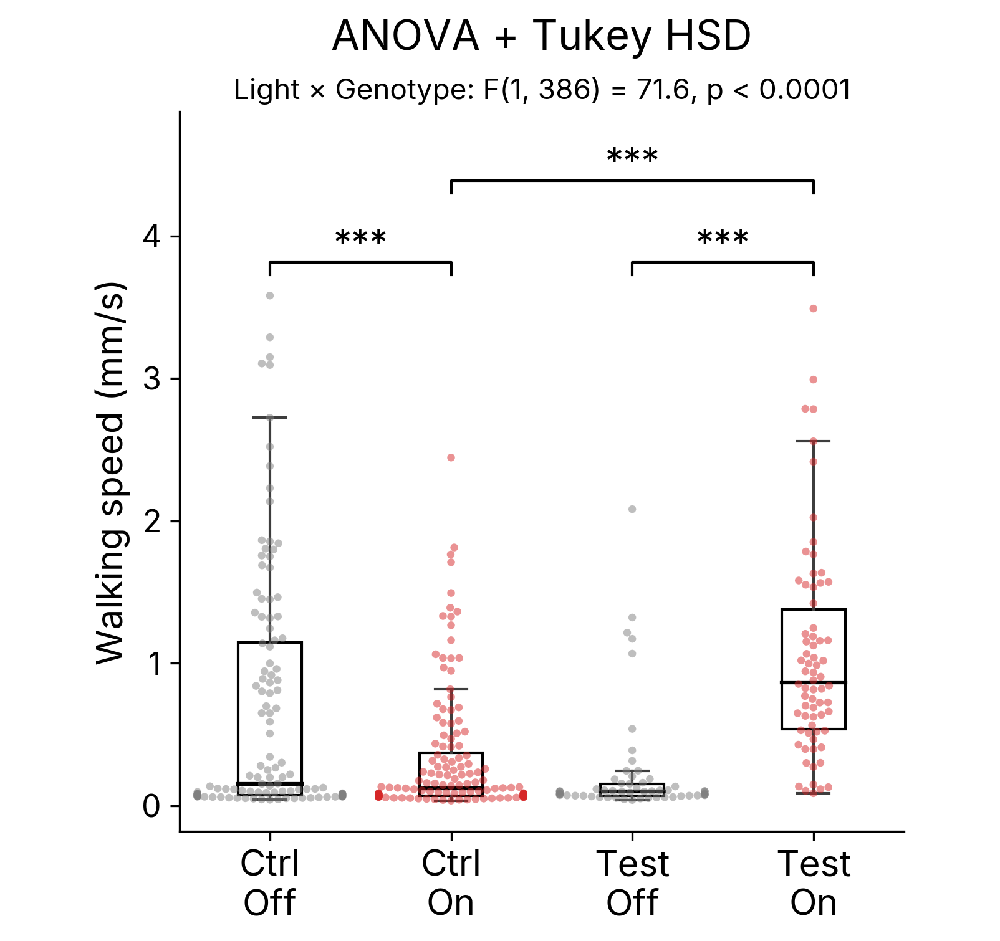
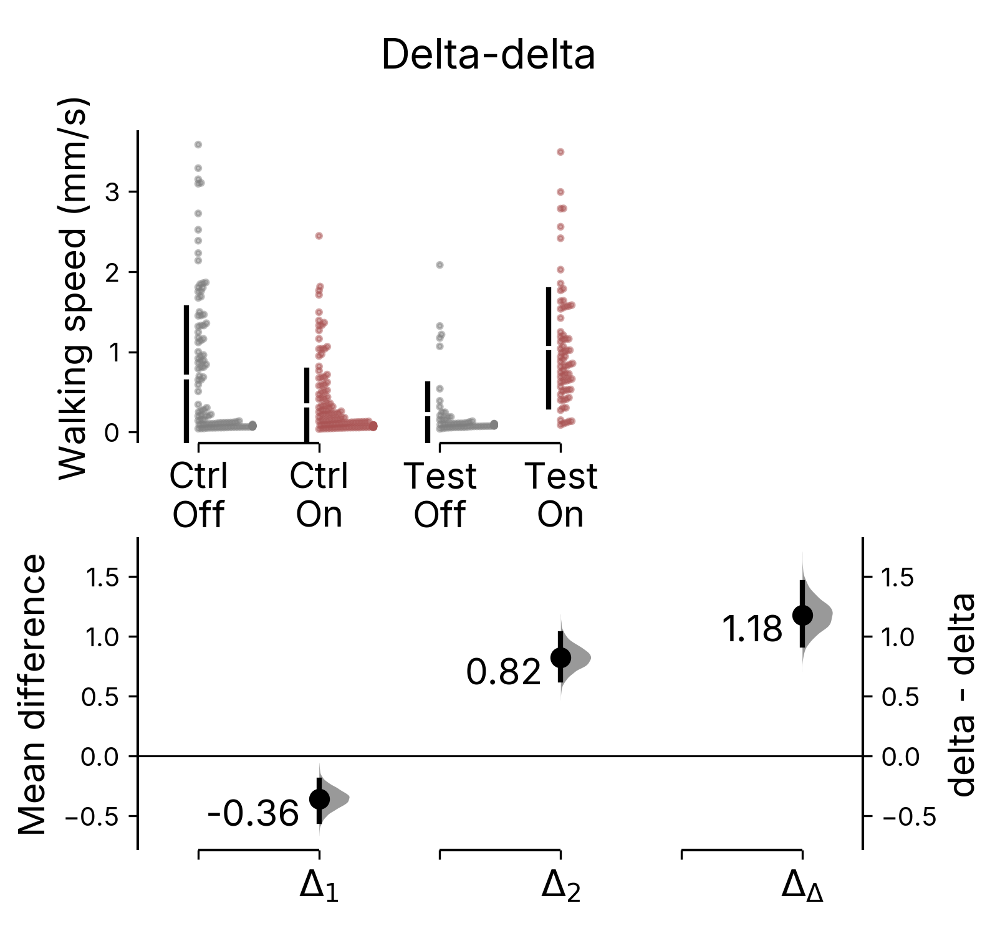
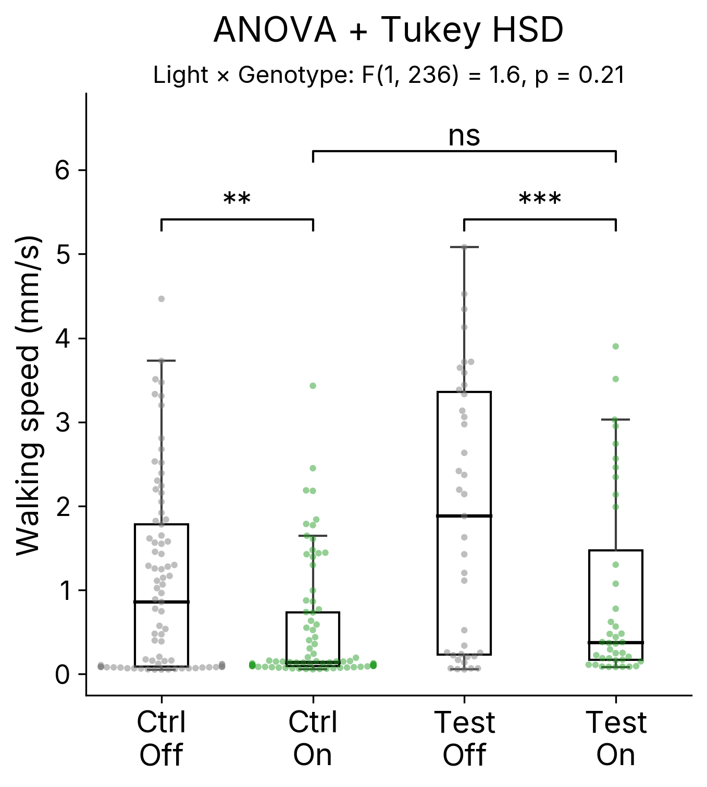
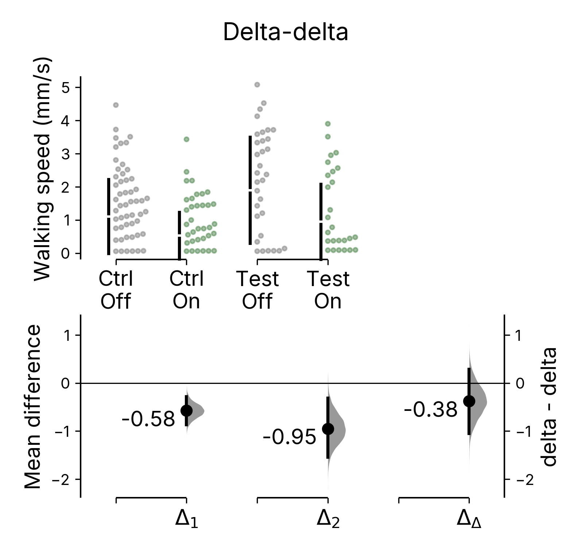

# Significant and Significant

*Light is an intervention on control animals too.*

Optogenetics won the Nobel Prize in Medicine two weeks ago. Hegemann and Nagel found a light-gated channel in algae, Deisseroth put it into neurons, and then a whole field learned to switch cells on with a flash of light. The experiment that follows is typically of the same configuration. You got your two genotypes: control animals that carry only the cre or gal4 driver or only response element but do not express an opsin in meaningful ways, and test animals that carry both and do express an opsin. These animals are tested with 2 conditions: light off (control condition) and light off (test condidtion). The optical axis and the genetic axis of this configuration make up the two halves of opto-genetics. From the data generated from the 4 groups, we try to infer what the nerons do. If everything works and we are correct about our hypothesis, there should be no effect due to light, no effect due to genetics, only effect due to the combined optogenetics specifically.

The textbook analysis is a two-way ANOVA with post-hoc tests, and it leaves me with a sentence I often find hard to write. The post-hoc table hands back one p-value for light off versus on in the controls and another for the test animals, and the hope is that the first is "not significant" and the second is. With a few hundred flies, the first one often isn't. Light at optogenetic intensity is visible to a fly, and the fly does something about it (in our rig, it slows down). That isn't a failed experiment. It is what the controls are for. But I would still have to write "light changed the controls, p = 0.0001, and light changed the test flies, p < 0.0001", and the reader is none the wiser about how much the neurons mattered. Of course the ANOVA interaction term is supposed to rescue this. Reported with its large F and its tiny p, it makes the specificity of the effect feel reassuring: light did something different to the test flies than to the controls. But somewhere in that table the experiment stopped being measured in millimeters per second and started being measured in variance explained, and most of my intuition about it went with the units.

## Optogenetics in real flies

Here is a case from our serotonin paper. R50H05 neurons, a serotonergic population, activated with CsChrimson under red light. The measure is each fly's mean walking speed over a two-hour assay, 390 flies in all.

Left: two-way ANOVA with Tukey HSD. Every fly, a box for median and quartiles, brackets with Tukey-adjusted significance. Right: the same 390 flies as a delta-delta plot. Mean and standard deviation on top; each effect size below with its bootstrap distribution and 95% CI.

Red light slowed the controls and sped up the test flies. Both post-hoc contrasts carry three stars. The ANOVA table has a tell, though: the main effect of light comes out at p = 0.57, because the two effects cancel in the marginal mean. A reader following the table would conclude that light did nothing, which is false for every fly in the experiment. The post-hoc tests recover what happened, but we normally take from them two p-values and no magnitude. The interaction tests the right contrast. But when we report only its F statistic and p-value, we still haven’t told the reader how large that contrast is. Overall, I just feel that my head spun around something twice and got a little lost.

## Why don't we just subtract

The delta-delta asks the question directly. Δ₁ is the light effect in controls, what light does to a fly that cannot respond through the channel. Δ₂ is the light effect in test flies, the same non-specific response plus whatever the neurons did. Δ₂ − Δ₁ is the additional light response in the opsin-expressing flies. If the non-specific light response is the same in both genotypes, this estimates the effect of activating the neurons. DABEST draws it with a bootstrap interval next to the two contrasts it was built from.

Red light changed walking speed by −0.36 mm/s [95% CI −0.54, −0.20] in control flies and by +0.82 mm/s [+0.63, +1.02] in R50H05 > CsChrimson flies. Net of the light response, driving the neurons changed walking speed by +1.18 mm/s [95% CI +0.93, +1.45]. One number, one interval, and it is the thing we did the experiment to measure.

This is the same estimand the ANOVA interaction tests (F(1, 386) = 71.6, which is why that row is so emphatic). The ANOVA agrees that the difference of differences is the right quantity. It just reduces it to a p-value and sends you to a table of six comparisons to find out which groups moved. (I compared the delta-delta with regression and ANOVA interaction terms in [an earlier post](05_delta_delta_same_estimate_different_uncertainty.html): same arithmetic, different interval.)

The test flies were already slow at light-off (0.22 mm/s against 0.69 for controls), so the light-induced slowing may have had less room to express itself in them, and subtracting the full 0.36 would then overestimate. The answer is that the effect is bracketed. If light slowed test flies as much as it slowed controls, the neuron effect is the delta-delta, +1.18, back in millimetres per second. If it slowed them not at all, the effect is Δ₂ alone, +0.82 [0.63, 1.02]. Either way it is large, positive and excludes zero. The additivity assumption only decides where in that bracket it sits, and the ANOVA interaction makes the same assumption without saying so.

## The other case of "significant and significant"

I was briefly worried that the opposite directions made this case look like a flattering choice of arithmetic. The second case presents a interesting contrast. Trh > ACR1, green light silencing all serotonergic neurons, 240 fed flies. Green light slowed the controls (p = 0.006) and slowed the test flies even more (p = 0.0009). Both contrasts significant, same direction, and the interaction isn't (p = 0.21). Read off the post-hoc table, the test contrast looks like a strong result.

Trh &gt; ACR1 under green light. Left: both light contrasts significant, interaction not. Right: the delta-delta is −0.38 mm/s [−1.05, +0.29]. The interval spans zero.

Read off the delta-delta, most of it is light. Δ₁ = −0.58 mm/s [−0.87, −0.29], Δ₂ = −0.95 [−1.54, −0.32], and the net effect is −0.38 [−1.05, +0.29]. The subtraction cuts both ways, which is what makes the first case a measurement rather than a trick.

## Why this is the estimation argument

A p-value answers "is there a difference". An effect size with its interval answers "how much, and how sure are we". For a 2×2 design the delta-delta is the number that answers it. We wrote it into DABEST 2.0 because it makes the sentence much easier to write.

---

*The data are the per-fly tables from [Contextualized phenovectors reveal a Drosophila serotonergic circuit controlling satiety &nearr;](https://doi.org/10.64898/2026.07.01.735755), bioRxiv (2026), in revision at Science Advances. The delta-delta is in [DABEST 2.0 &nearr;](https://www.nature.com/articles/s41592-026-03187-7), Nature Methods (2026); for how its bootstrap interval differs from a regression interaction's, see [Interactions, Delta-Deltas, and How We Measure Uncertainty](05_delta_delta_same_estimate_different_uncertainty.html). Try it at [estimationstats.com](https://www.estimationstats.com).*

The fly data were collected with Xianyuan Zhang, James C. Stewart, Joses Ho, Deepak Choudhury, Zhiping Wang and Adam Claridge-Chang. The delta-delta was built with <a href="https://www.nature.com/articles/s41592-026-03187-7" target="_blank">the DABEST Team</a>. Grateful for institutional and funding support from A\*STAR Institute of Molecular and Cell Biology, Duke-NUS Medical School, and the National Medical Research Council, Singapore during this work.

