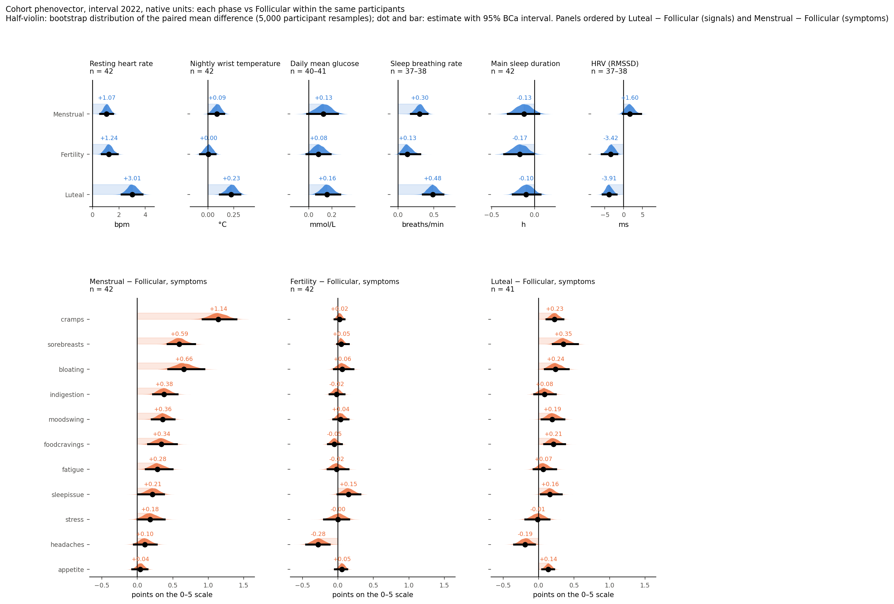
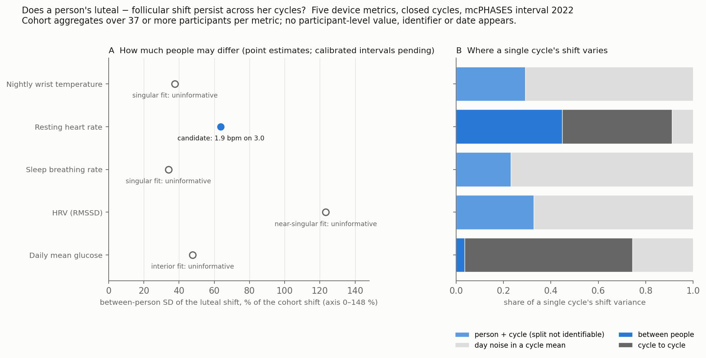

# PhenoVector AI: Estimating Within-Person Physiology with Governed AI

*How much does a recurring state move a person's physiology, and does the movement repeat?*

Wearables follow the same person for months, allowing us to track changes in their physiology over time. Some changes may reflect improvements or deterioration in health, while others follow recurring biological states, such as the menstrual cycle. These recurring states raise two questions: how much does a state shift a person's physiology, and does that person show a similar shift each time? 

A cohort average tells us how much people shift on average, but not whether everyone responds similarly or a few people account for most of the change. Cohort-level effects help researchers understand population trends. For individual users, an additional question is whether their own history tells us anything about their future physiological responses beyond what the cohort average already predicts.

PhenoVector AI answers the first with a phenovector. Each participant's metrics are averaged over the days carrying a state label and compared with that participant's reference days; the paired differences across all metrics form one profile, with the participant as the unit of analysis. Each entry is a mean difference in native units, bpm, °C or mmol/L, with a 95% bootstrap interval from [DABEST](01_dabest.qmd).

<figure style="margin:2.5rem auto; max-width:900px;">

<figcaption style="margin-top:0.6rem; font-size:0.82rem; color:var(--warm-grey); line-height:1.5;">Cohort phenovector from phaseffect, interval 2022: each phase against the same participants' follicular days. Top, six device metrics in native units; bottom, eleven diary symptoms on their 0–5 scale. Half-violins show the bootstrap of the paired mean difference over 5,000 participant resamples; dot and bar, the estimate with its 95% BCa interval. Luteal − follicular resting heart rate: +3.01 bpm [2.22, 3.79], 37 of 42 participants higher. Source: <a href="https://sangyu.github.io/phaseffect/cohort-shifts.html">phaseffect, Cohort shifts by phase</a>.</figcaption>
</figure>

For the second, each record is split into complete cycles. A [three-level mixed model](https://sangyu.github.io/phaseffect/methods.html#statistics) (person, cycle, day) gives the between-person spread of each metric's shift, and a [distance-based intraclass correlation](https://sangyu.github.io/phaseffect/methods.html#statistics) asks whether a person's own cycle vectors lie closer together than other people's. Variances cannot fall below zero, so bootstrap intervals mislead at that boundary; the method instead simulates a no-difference cohort on the real design (still in progress for phaseffect) and reports boundary fits as uninformative. I first test the analyses on synthetic cohorts with known effects, checking that the code recovers what I put in and finds nothing where there is nothing to find.

<figure style="margin:2.5rem auto; max-width:900px;">

<figcaption style="margin-top:0.6rem; font-size:0.82rem; color:var(--warm-grey); line-height:1.5;">Does a person's luteal − follicular shift persist? Five device metrics over closed cycles. A: between-person SD of the shift as a share of the cohort shift; hollow markers are singular fits, reported as uninformative. B: how much of a single cycle's shift comes from the person, the cycle, and day noise. Resting heart rate is a candidate at 1.9 bpm on a 3.0 bpm contrast; calibrated intervals from simulation are in progress and withheld meanwhile. Source: <a href="https://sangyu.github.io/phaseffect/repeatability.html">phaseffect, Does a person's shift persist?</a></figcaption>
</figure>

I also wanted to see how much of the analysis I could delegate to AI without giving up control of the data or the results. Agents write and test code using synthetic data, but I review and approve every script before it can access real measurements. Any change to the code requires another approval, and approved scripts [return only aggregate results](https://sangyu.github.io/phaseffect/methods.html#disclosure). The calculations are done by ordinary code, and every reported number can be traced back to how it was computed. Four independent AI reviewers check the calculations and the claims made from them. None of this is foolproof. The safeguards depend on my reviewing the code properly, and four reviewers agreeing doesn't necessarily mean they're right.

The first application is [phaseffect](https://sangyu.github.io/phaseffect/): 42 participants in the [mcPHASES cohort](https://physionet.org/content/mcphases/1.0.0/), three months of wearable, glucose, hormone and diary data. Its estimation core is DABEST; its cross-metric profile is [DESTRA's phenovector](02_ethomics.qmd), deltas compared as a whole profile, here computed within a person rather than across groups. Nothing in the method is specific to the menstrual cycle; it applies wherever a labelled state recurs in people measured repeatedly.

Results, tables and figures: [phaseffect site](https://sangyu.github.io/phaseffect/) · [GitHub](https://github.com/sangyu/phaseffect) (results site and cohort-level tables; analysis code release planned for 13 November 2026).

## References

- Lin, B., Li, J. Y., Kalani, K., Truong, K., & Mariakakis, A. (2025). *mcPHASES: A Dataset of Physiological, Hormonal, and Self-reported Events and Symptoms for Menstrual Health Tracking with Wearables* (version 1.0.0). PhysioNet. [doi:10.13026/zx6a-2c81](https://doi.org/10.13026/zx6a-2c81).
- Pollard, T., et al. (2026). PhysioNet as a global platform for biomedical research. *Nature Health*. [doi:10.1038/s44360-026-00096-z](https://doi.org/10.1038/s44360-026-00096-z).
- Lin et al. (2026). *Scientific Data*. [doi:10.1038/s41597-026-06805-3](https://doi.org/10.1038/s41597-026-06805-3).
