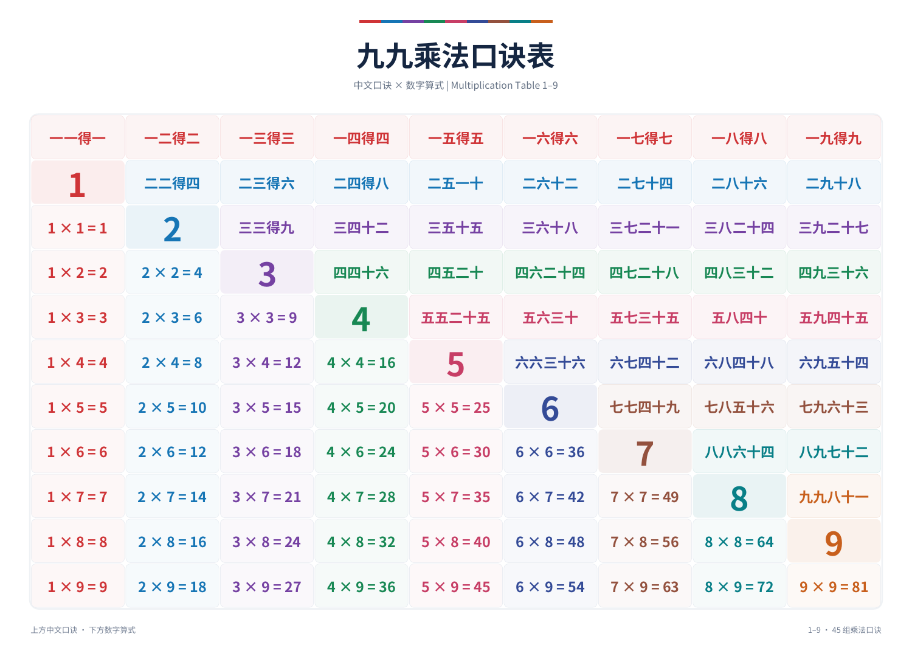

::: {.learning-resource}
[Bilingual Learning](../bilingual-learning.qmd){.learning-back-link}

# Chinese Multiplication Table

[九九乘法口诀表]{lang="zh-Hans" .learning-chinese-title}

A printable multiplication chart for learning the 1–9 times tables with Chinese multiplication chants ([乘法口诀]{lang="zh-Hans"}). I made it for my children to connect the words they say aloud with the equations they recognise on the page.

[这份九九乘法口诀表是我为孩子制作的数学学习材料，将 1 至 9 的中文乘法口诀与数字算式放在同一张表上，方便一边读口诀，一边理解乘法。家长也可以和孩子一起用中英文说出算式，在练习乘法的同时接触两种语言。]{lang="zh-Hans"}

::: {.learning-downloads}
[Download PDF · 下载 PDF](../files/learning/chinese-multiplication-table.pdf){.learning-download download="chinese-multiplication-table.pdf"}
[Open PDF · 在线查看](../files/learning/chinese-multiplication-table.pdf){.learning-open}
:::

One page · A3 landscape · Chinese chants and numerical equations

```{=html}
<a class="learning-preview" href="../files/learning/chinese-multiplication-table.pdf" aria-label="Open the Chinese multiplication table PDF">
  
</a>
```

## What's in the printable

The chart brings together all 45 multiplication facts from 1 × 1 to 9 × 9. Chinese chants sit above the diagonal, and the corresponding numerical equations sit below it. Each number has its own colour to help children follow the pattern across the page.

The chants use simplified Chinese characters. The chart has an English subtitle, while the learning content pairs Chinese with mathematical notation. It does not include pinyin or English translations of the chants.

## Learning together

Try a few facts at a time. Say a chant aloud, find its matching equation, and read the equation in English. For example, [三四十二]{lang="zh-Hans"} goes with 3 × 4 = 12: “three times four is twelve.”

Once a row feels familiar, cover an answer and take turns recalling it. You can also look for repeated answers and talk about how swapping the two factors leaves the product unchanged.

## Printing

The PDF is designed for **A3 paper in landscape orientation**. For A4 or US Letter, choose landscape and “fit to page” in your printer settings; the text will be smaller. Print in colour to keep the visual grouping of the times tables.

::: {lang="zh-Hans"}
## 九九乘法口诀表：内容与使用方法

这张可打印的九九乘法口诀表包含从一一得一到九九八十一的 45 组乘法口诀。表格上方是中文口诀，下方是对应的数字算式，并用不同颜色区分各组，方便孩子对照练习。

口诀使用简体中文，配有英文副标题；表内以中文口诀和数学符号为主，不含拼音或口诀的英文翻译。

### 怎样和孩子一起练习

每次选几组口诀，先一起读，再找对应的算式。例如，读到“三四十二”时，找到 3 × 4 = 12，再用英语说出“three times four is twelve”，把中文表达、英文表达和数学概念联系起来。

熟悉之后，可以遮住答案，轮流回忆；也可以找一找哪些算式的答案相同，讨论为什么交换两个乘数的位置，结果仍然一样。不必一次背完整张表，可以根据孩子的兴趣和熟悉程度慢慢练习。

### 下载与打印

文件为单页 A3 横向 PDF。点击页面上方的“下载 PDF”即可保存，或选择“在线查看”先浏览完整表格。建议彩色打印，以保留各组口诀的颜色区分。使用 A4 或 Letter 纸时，请选择横向并缩放至适合纸张大小，文字会相应缩小。
:::
:::
